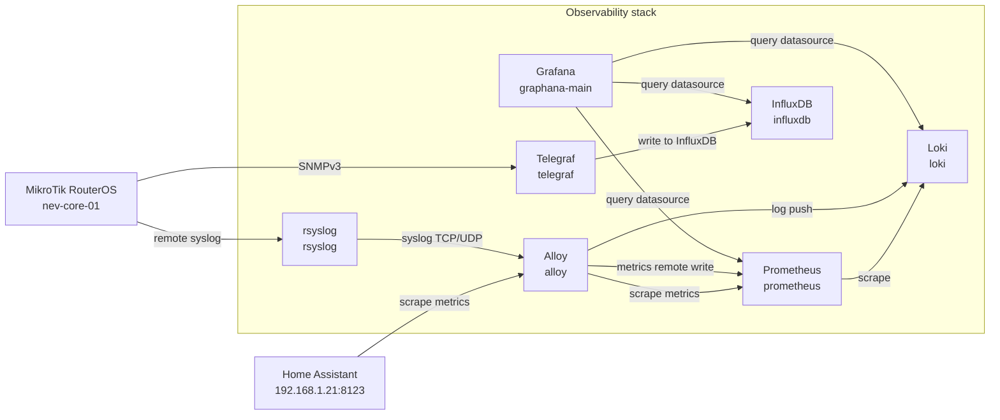

# nev-home

Infrastructure as Code for managing a local MikroTik RouterOS router and observability stack (Grafana, Prometheus, InfluxDB, Telegraf, Loki, Alloy).

Instead of running raw OpenTofu or Terraform directly, this repository uses **`nevctl`** — a dedicated Go command-and-control CLI that integrates with the Linux system keyring to dynamically hydrate configuration templates before invoking OpenTofu. Sensitive credentials are kept in the OS keyring and never committed to git.

---

## Prerequisites

- **OpenTofu** (recommended `>= 1.6`, verify with `tofu version`) or Terraform.
- **Go** (`>= 1.22`, verify with `go version`) to build the `nevctl` CLI.
- **Linux Keyring / Secret Service** (`gnome-keyring`, `libsecret`, or any DBus Secret Service provider) for secure credential storage.
- **Docker** or **Podman** for running the observability stack containers.
- **Network connectivity** to the RouterOS device (defaults to `https://nev-core-01.local`). Ensure DNS or `/etc/hosts` resolves the hostname.
- **RouterOS user**: A user (default `tfuser`) with sufficient privileges to manage interfaces, IP addresses, DHCP, certificates, and SNMP.

---

## Building `nevctl`

The `nevctl` source code lives in [`tools/nevctl`](tools/nevctl).

To compile the binary in the repository root:

```bash
cd tools/nevctl
go build -o ../../nevctl ./cmd/nevctl
cd ../..
```

*(Optional)* You can also install `nevctl` into your `$GOPATH/bin` or user PATH:

```bash
cd tools/nevctl
go install ./cmd/nevctl
```

---

## Initial Secret Setup

Rather than writing plaintext passwords into a `.tfvars` file, credentials are saved securely in the Linux system keyring under the service namespace `nev-home`.

Run `nevctl secret set` for each required secret. If you omit the value argument, you will be prompted securely for masked input:

```bash
# RouterOS credentials
./nevctl secret set tfuserpass

# SNMP credentials
./nevctl secret set snmp_authentication_password
./nevctl secret set snmp_encryption_password

# Grafana & Monitoring
./nevctl secret set graf_admin
./nevctl secret set influxdb_token

# Home Assistant bearer tokens (for Alloy and Prometheus)
./nevctl secret set alloy_ha_bearer
./nevctl secret set prometheus_ha_bearer
```

To view all configured secrets in the keyring for this service:

```bash
./nevctl secret list
```

To retrieve or delete a secret:

```bash
./nevctl secret get tfuserpass
./nevctl secret delete old_key
```

---

## Running OpenTofu via `nevctl`

`nevctl` wraps common OpenTofu commands with automated secret hydration and cleanup:

### 1. Initialize
```bash
./nevctl init
```

### 2. Review Planned Changes
```bash
./nevctl plan
```
You can pass standard OpenTofu flags:
```bash
./nevctl plan -out=tfplan
```

### 3. Apply Changes
```bash
./nevctl apply
```

### 4. Destroy Resources
```bash
./nevctl destroy
```

### 5. Arbitrary Pass-Through Commands
To execute any other OpenTofu command with hydrated secrets:
```bash
./nevctl tofu state list
./nevctl tofu show
```

---

## How It Works: Templating & Lifecycle

Template mappings and behavior are configured in [`nevctl.yaml`](nevctl.yaml):

```yaml
service: nev-home
tofu_binary: tofu

templates:
  - source: terraform.tfvars.tmpl
    dest: terraform.tfvars
    ephemeral: true

  - source: telegraf/telegraf.conf.tmpl
    dest: telegraf/telegraf.conf
    ephemeral: false

  - source: alloy/HA_Bearer.txt.tmpl
    dest: alloy/HA_Bearer.txt
    ephemeral: false

  - source: prometheus/HA_Bearer.txt.tmpl
    dest: prometheus/HA_Bearer.txt
    ephemeral: false
```

### Execution Lifecycle:
1. **Hydrate:** Prior to running OpenTofu, `nevctl` reads the committed `*.tmpl` files, looks up required credentials in the system keyring, and writes active files with `0644` permissions so local services and containers can read them.
   * If any secret required by a template is missing from the keyring, `nevctl` fails fast and lists all missing keys.
2. **Execute:** `nevctl` spawns OpenTofu and forwards OS signals (`SIGINT`/`SIGTERM`) cleanly, ensuring OpenTofu can finish writing state if interrupted.
3. **Clean:** 
   * **Ephemeral files** (like `terraform.tfvars`) are wiped immediately from disk upon exit in a deferred handler—even if OpenTofu fails or is interrupted.
   * **Persistent files** (like `telegraf.conf` or bearer tokens mounted by Docker containers) remain on disk so running containers continue functioning across restarts.

### Manual Render & Clean Commands

You can manually manage rendered files at any time:

```bash
# Render all templates without executing OpenTofu
./nevctl render

# Remove only ephemeral files (e.g. terraform.tfvars)
./nevctl clean --ephemeral-only

# Remove all rendered configuration files from disk
./nevctl clean
```

---

## Grafana Stack

The Grafana-based observability stack deployed by the [`modules/graphana`](modules/graphana) Terraform module runs as Docker containers on the `tig` bridge network. The diagram below shows the deployed components and how they connect to each other:



**Deployed components:**

- **Grafana** (`graphana-main`, host port `3000`) — the UI layer; queries the Prometheus, Loki, and InfluxDB datasources.
- **Prometheus** (`prometheus`, host port `9090`) — scrapes Loki and Home Assistant, and receives metrics from Alloy via remote write.
- **Loki** (`loki`, host port `3100`) — receives log entries pushed by Alloy.
- **Alloy** (`alloy`, ports `12345`/`12346`/`12347`) — discovers Docker containers, collects logs for Loki and scrapes metrics for Prometheus.
- **Telegraf** (`telegraf`, host port `8125`) — SNMP collector that writes to InfluxDB.
- **InfluxDB** (`influxdb`, host port `8086`) — time-series database receiving from Telegraf.
- **rsyslog** (`rsyslog`, host port `10514`) — syslog receiver forwarding to Alloy.

---

## Troubleshooting

- **Keyring unlocked/headless session:** If using `nevctl` in a headless SSH or pure TTY session, ensure your keyring daemon is running and unlocked:
  ```bash
  export $(echo -n "" | gnome-keyring-daemon --start --unlock --components=secrets)
  ```
- **RouterOS Connectivity:** If OpenTofu fails to connect to the router, verify DNS and TLS reachability:
  ```bash
  curl -vk https://nev-core-01.local
  ```
- **Custom OpenTofu Binary:** If OpenTofu is located at an alternative path, set `tofu_binary` in `nevctl.yaml` or export the `TOFU_BIN` environment variable:
  ```bash
  export TOFU_BIN="/usr/local/bin/tofu"
  ```
